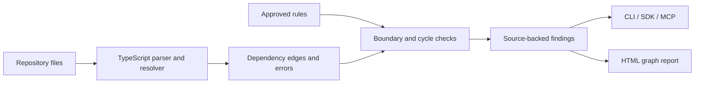

<div align="center">

<h1>RepoContract</h1>
<p><strong>Turn architecture rules into checks your coding agent can use.</strong></p>
<p>Find forbidden imports and dependency cycles in TypeScript repositories, with the source lines that explain each finding.</p>

<p>
  <a href="https://github.com/Balaji91221/repocontract/actions/workflows/ci.yml"></a>
  <a href="https://github.com/Balaji91221/repocontract/blob/main/LICENSE"></a>
  
  
  
</p>

<p><a href="#why-i-built-it">Why</a> · <a href="#quick-start">Quick start</a> · <a href="#usage">Usage</a> · <a href="#architecture">Architecture</a> · <a href="#documentation">Documentation</a></p>
</div>


## Why I built it

As an AI engineer, I want coding assistants to respect the structure of a project as well as produce working code. A change can pass its tests while quietly bypassing the service layer or introducing a dependency cycle. Architecture notes are useful, but a reviewer still needs a way to check them.

I built RepoContract to make a small set of those rules executable. It connects a declared dependency boundary to the imports in the repository, so a developer or coding agent can see exactly where a change crosses that boundary.

**Example:** your rule says API routes must use application services. A new route imports the database directly. RepoContract reports the rule, file, import, and source line—even if the application still runs.

## What it helps you do

| Need | RepoContract provides |
|---|---|
| Preserve module boundaries | Explicit rules for forbidden imports between path prefixes |
| Inspect dependencies | TypeScript-based resolution, dependency edges, and cycle checks |
| Review an agent's patch | Checks in a disposable Git snapshot |
| Give assistants architectural context | Read-only MCP tools for rules and repository checks |
| Start from an architecture document | Reviewable rule proposals, with source evidence and explicit approval |

Useful for TypeScript maintainers, teams using coding assistants, and developers turning design decisions into CI checks.

## Quick start

Requires **Node.js 22.18+**. The basic checks need no LLM or API key. The npm package and SDK import are `@kelavathbalajinaik/repocontract`; the executable remains `repocontract`.

```bash
npm install @kelavathbalajinaik/repocontract@0.2.1
npx repocontract demo
```

The demo deliberately contains a forbidden route-to-database import. It reports `complete: true`, a violation with rule ID `routes-no-db`, and exits with **code 1**. This means the rule caught the example problem.


*Actual report generated from the included example repository. Findings link a declared rule to source evidence.*

## Usage

### Declare a boundary and check your repository

Save this as `rules.json` in your project:

```json
{
  "rules": [{
    "id": "routes-no-db",
    "from": "src/routes",
    "forbid": ["src/database"],
    "reason": "Routes must use application services"
  }],
  "cycles": true
}
```

From your project directory:

```bash
npx repocontract check . rules.json
```

Scopes are exact relative paths or directory prefixes, not globs. Install your target project's dependencies first when imports require external resolution.

| Exit code | Meaning |
|---|---|
| `0` | Analysis completed without violations |
| `1` | Analysis completed and found violations |
| `2` | Invalid input, an analysis error, or incomplete resolution |

### Use the SDK

```bash
npm install @kelavathbalajinaik/repocontract@0.2.1
```

```ts
import { readFileSync } from 'node:fs';
import { checkRepository } from '@kelavathbalajinaik/repocontract';

const rules = JSON.parse(readFileSync('./rules.json', 'utf8'));
const result = checkRepository('/absolute/path/to/your-project', rules);
console.log(result.complete, result.violations, result.errors);
```

### Connect an MCP client

Add a server entry in an MCP client that accepts `mcpServers` configuration, replacing the paths with your own:

```json
{
  "mcpServers": {
    "repocontract": {
      "command": "npx",
      "args": [
        "-y", "--package", "@kelavathbalajinaik/repocontract@0.2.1", "repocontract", "serve",
        "/absolute/path/to/your-project",
        "/absolute/path/to/your-project/rules.json"
      ]
    }
  }
}
```

The server exposes two read-only tools:

```text
get_rules({"file_path": "src/routes/orders.ts"})
check_repository({})
```

It is bound to the configured root and rules. Restart it after changing the approved rules. Rule drafting and approval use the CLI or SDK.

## Architecture



| Component | Responsibility |
|---|---|
| [`checkRepository`](https://github.com/Balaji91221/repocontract/blob/main/src/index.ts) | Resolve static imports, evaluate boundaries, and report incomplete analysis |
| [`onboarding`](https://github.com/Balaji91221/repocontract/blob/main/src/onboarding.ts) | Draft rules from a document; validate evidence and approval |
| [`checkPatch`](https://github.com/Balaji91221/repocontract/blob/main/src/patch.ts) | Apply a proposed patch to a disposable Git snapshot and scan it |
| [`MCP server`](https://github.com/Balaji91221/repocontract/blob/main/src/mcp.ts) | Expose root-bound, read-only checks to assistants |
| [`report renderer`](https://github.com/Balaji91221/repocontract/blob/main/src/report.ts) | Display dependency edges, violations, and analysis errors |

An optional LLM can **propose** rules. Approved rules and the deterministic analyzer decide the findings. The [architecture guide](https://github.com/Balaji91221/repocontract/blob/main/docs/architecture.md) explains the HLD, LLD, and approval flow.

## Current scope

- Static dependency analysis for supported JavaScript/TypeScript imports; it does not prove runtime architecture.
- Dynamic module paths, unresolved dependencies, and symlinks produce incomplete analysis rather than a clean pass.
- Patch checks do not modify your working tree or automatically install dependencies.
- Model-assisted proposals require explicit configuration and review. Basic checks work offline.

## Documentation

| Start here | Go deeper |
|---|---|
| [Usage, reports, and rule onboarding](https://github.com/Balaji91221/repocontract/blob/main/docs/usage.md) | [Architecture: HLD and LLD](https://github.com/Balaji91221/repocontract/blob/main/docs/architecture.md) |
| [Implemented features](https://github.com/Balaji91221/repocontract/blob/main/FEATURE_MATRIX.md) | [Project plan](https://github.com/Balaji91221/repocontract/blob/main/PROJECT_PLAN.md) |
| [Verification and release scope](https://github.com/Balaji91221/repocontract/blob/main/IMPLEMENTATION_STATUS.md) | [Security policy](https://github.com/Balaji91221/repocontract/blob/main/SECURITY.md) |

## Development

```bash
git clone https://github.com/Balaji91221/repocontract.git
cd repocontract
npm ci
npm run typecheck
npm run build
npm test
npm run eval
```

See [CONTRIBUTING.md](https://github.com/Balaji91221/repocontract/blob/main/CONTRIBUTING.md), or open a [GitHub issue](https://github.com/Balaji91221/repocontract/issues) with a small reproduction. Released under the [MIT License](https://github.com/Balaji91221/repocontract/blob/main/LICENSE).
