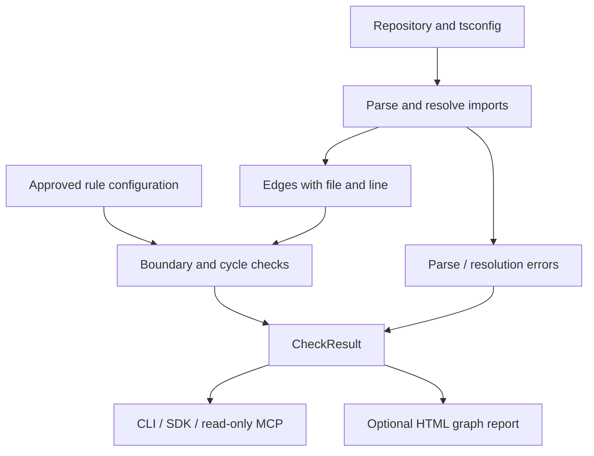
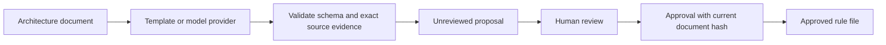

# RepoContract architecture

[← README](../README.md) · [Usage guide](usage.md)

RepoContract checks declared dependency boundaries against source code. This guide describes the implemented 0.2.1 design, including the optional proposal flow.

## High-level design

Repository checking is a local, synchronous analysis. The TypeScript compiler API parses supported source files and resolves imports. The resulting edges are checked against approved rules and optional cycle detection. The caller receives findings and completeness errors.



There is no application database or hosted service. Ordinary checks read the caller-selected repository. Reports and rule files are explicit local outputs. Git is required only for patch snapshots.

## Low-level design

| Module | Main contract | Responsibility |
|---|---|---|
| [`src/index.ts`](../src/index.ts) | `checkRepository(root, config)` | Validate rules, build edges, detect boundaries/cycles, and report completeness |
| [`src/onboarding.ts`](../src/onboarding.ts) | `ProposalProvider.propose(document, signal)` | Obtain candidate rules from templates or an explicitly configured model/JSON provider |
| [`src/onboarding.ts`](../src/onboarding.ts) | `proposeRules` / `approveProposal` | Validate proposals against source lines and current document hashes |
| [`src/patch.ts`](../src/patch.ts) | `checkPatch(repo, base, patch, config)` | Materialize a Git commit, apply a patch in a temporary directory, check, and clean up |
| [`src/mcp.ts`](../src/mcp.ts) | `get_rules` / `check_repository` | Expose fixed-root, fixed-config read-only tool access |
| [`src/report.ts`](../src/report.ts) | `renderReport(result)` | Build a self-contained dependency graph and evidence report |
| [`src/cli.ts`](../src/cli.ts) | CLI commands | Compose the above components and map results to exit codes |

### Core data

```ts
type Rule = {
  id: string;
  from: string;
  forbid: string[];
  reason: string;
  reference?: string;
};
type Edge = { from: string; to: string; line: number; specifier: string };
```

`CheckResult` contains `complete`, file count, dependency edges, violations, and analysis errors. Each boundary violation retains the matching rule ID and reason plus the offending edge. Scope matching uses repository-relative path prefixes, not globs. The [configuration schema](../schemas/rules.schema.json) documents the serialized input; runtime checks additionally reject duplicate IDs and unsafe scopes.

## Request flow: a route imports the database

1. A CLI, SDK caller, or MCP client selects the repository and approved rules.
2. The analyzer reads root `tsconfig.json` options and discovers supported source files.
3. It uses TypeScript AST nodes and module resolution to build source-located edges.
4. For each edge, it matches the source and target against the declared rule scopes.
5. The route-to-database edge produces a violation with the rule's explanation.
6. The caller can fail CI, show evidence to an assistant, or render an HTML graph.

The analyzer never executes repository scripts. Type-only imports are still dependencies for these checks. External library imports resolved into `node_modules` are not local boundary edges.

## Optional proposal and approval flow



A proposal contains the document path/hash, provider name, candidate rules with exact lines, unhandled statements, and `reviewed: false`. The default template provider accepts a deliberately small grammar. Ambiguous statements remain unhandled.

Optional model providers send the selected document to the configured endpoint. Provider output cannot bypass validation or approve itself. Approval checks that the document and evidence still match before creating the rule file. It does not rewrite the architecture document. MCP exposes neither proposal approval nor file mutation.

## State, failure behavior, and boundaries

| Condition | Behavior |
|---|---|
| Complete scan with no violations | CLI exit `0` |
| Complete scan with violations | CLI exit `1` |
| Parse failure, unresolved import, or unsupported dynamic path | Incomplete result; CLI exit `2` |
| Symlink encountered in repository analysis | Reported as an analysis error |
| Rule scopes escape the repository or use globs | Configuration rejected |
| Patch includes unsupported file types or symlinks | Snapshot check rejected |
| Document changes after proposal | Approval fails rather than using stale evidence |

Patch checking uses a selected committed Git tree. It excludes unrelated working-tree changes, rejects submodules/symlinks, applies the supplied ordinary text patch in a disposable directory, and cleans up afterward. It does not install dependencies; unresolved imports may therefore produce incomplete analysis.

The MCP server loads its root and rules on startup. Tool arguments cannot redirect it to another repository. Restart after an approved configuration change.

## Design decisions

- **Compiler-based edges:** AST parsing and TypeScript module resolution provide context that text matching cannot, while still having explicit static-analysis limits.
- **One deterministic checker:** CLI, SDK, MCP, and patch checks reuse the same result semantics.
- **Replaceable proposal providers:** the narrow `ProposalProvider` interface supports templates and external models. Each must return data that passes the same schema/evidence checks.
- **Approval outside providers:** a model can propose a rule; it cannot make it authoritative.
- **Reports outside analysis:** rendering may change without changing which imports violate a rule.

These choices apply single responsibility, dependency inversion at the provider boundary, and composition without introducing a plugin framework. Most analysis remains simple functions; extra interfaces would not improve the fixed checking flow.

## Verification and limits

Run `npm run typecheck`, `npm run build`, `npm test`, and `npm run eval` from the root. [Tests](../test) cover resolution, boundaries, cycles, incomplete scans, MCP access, proposal validation, and disposable patch checks. The [onboarding evaluation](../scripts/evaluate-onboarding.mjs) checks held-out template cases separately from provider transport tests.

Passing these checks establishes the supported static boundaries. It does not establish runtime call paths, service-level behavior, architectural completeness, or live model quality.
